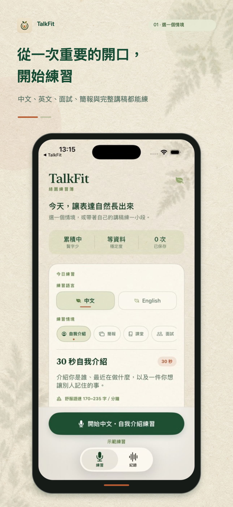
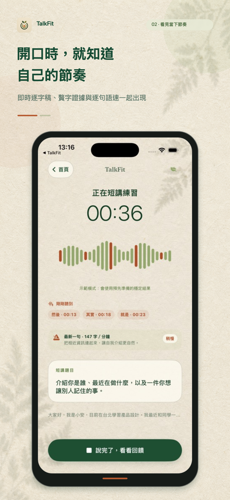
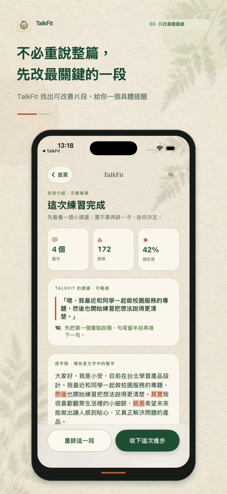
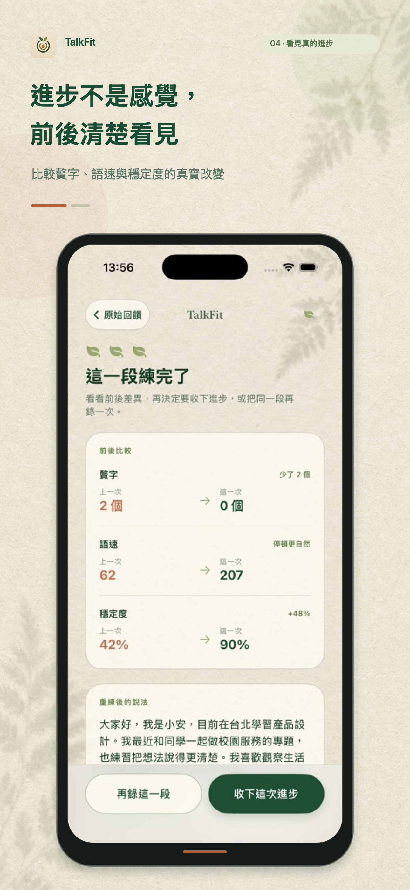
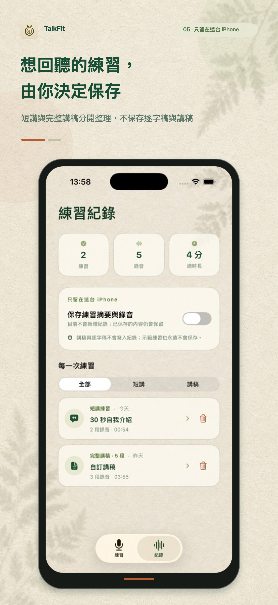

<div align="center">


# TalkFit

**Let every time you speak become growth you can see.**

[繁體中文](README.md) ｜ English

<p>
  <a href="https://talkfit.sandy-domains.workers.dev/"></a>
  
  <a href="README.md"></a>
  
</p>

<p>
  
  
  
  
  
</p>

</div>

> The moment a sentence leaves you, it still carries a little doubt.  
> Um, and then, you know — the places where you stopped to think  
> are footprints left by a thought still on its way.  
> Pick them up gently, and say it once more.  
> Slowly, your voice grows into the shape you meant.

## What it is

TalkFit is a practice notebook that fits in your pocket, and a quiet coach who never hurries you.

Speak for thirty seconds in Traditional Chinese or English. TalkFit lays out the transcript, circles the filler words, measures the pace of each sentence and the pause at its end, and then picks **the one small part most worth fixing** and asks you to say it again, right away. When you finish, the two takes sit side by side, and progress stops being just a feeling.

There are no leaderboards, no accounts and no backend. The analysis happens on this iPhone, and whether a recording is kept is up to you.

- Product site: https://talkfit.sandy-domains.workers.dev/
- Full technical notes (in Chinese): [`docs/technical-notes.md`](docs/technical-notes.md)
- What comes next (in Chinese): [`TODO.md`](TODO.md)

The app's interface is in Traditional Chinese for now. "English" is the language you speak and the language it listens for.

## A walk through one practice

<table>
  <tr>
    <th width="20%">01<br>Pick a scene</th>
    <th width="20%">02<br>Hear your rhythm</th>
    <th width="20%">03<br>Fix what matters most</th>
    <th width="20%">04<br>See real progress</th>
    <th width="20%">05<br>Stays on this iPhone</th>
  </tr>
  <tr>
    <td></td>
    <td></td>
    <td></td>
    <td></td>
    <td></td>
  </tr>
  <tr>
    <td valign="top">Chinese or English. A self-introduction, a pitch, a class report, an interview answer, or a script of your own.</td>
    <td valign="top">As you speak, the waveform breathes with you, and your pace and latest fillers are right there.</td>
    <td valign="top">No need to start over. Get one clear priority, then practise the sentence that matters.</td>
    <td valign="top">How many fillers are gone, how much steadier the pace, how many fewer rhythm notes: all at a glance.</td>
    <td valign="top">Keep only the takes you want to hear again. Stop saving or delete them whenever you wish.</td>
  </tr>
</table>

## What is inside the notebook

**Fillers you can write down**
"Like", "you know", "actually", or 「然後」「就是」「其實」. Fillers in the transcript are marked in clay orange, and you can add your own habits to the filler library.

**And the sounds you cannot**
To keep sentences readable, speech recognition often quietly drops "um" and "uh". So TalkFit also listens to the recording itself: a sound held for 0.4 seconds or more with a tone that barely changes is noted as one hesitation sound, listed under "also heard in the audio". It cannot tell an "um" from an "uh", so it does not guess for you.

**Pace that follows the clock**
While you record, pace comes from how many words you actually said in the last few seconds. Afterwards it is measured sentence by sentence, from the timing of each word. Every scene has its own comfortable range, for example 110 to 180 words per minute for an English self-introduction. Reading aloud runs a little faster than speaking off the cuff, so TalkFit only asks you to slow down when you are clearly past it.

**Half a beat at the end of a sentence**
Pauses that are too short or too long, or a sudden rush, each leave a short note about where to breathe next time.

**Two versions of every sample script**
Each scene comes with a script to read aloud, in a clean version and a filler version. The filler version has four fillers placed on purpose and marked in orange. Read it once and see how many TalkFit catches.

**Your own script**
Paste a full script and say it through once. Each paragraph then gets its own suggestion, and you can strengthen just one. The report points out key words you skipped, without asking you to recite it word for word.

**A demo that never pretends to be you**
When the microphone or speech recognition is unavailable, the app says so plainly instead of quietly swapping in sample content. Demo practice is something you choose, and it is never saved as your record.

**Growth you can watch**
Practise the same prompt three times and a trend chart appears: fillers, pace and steadiness, and where each one is heading.

## The little seed in the icon

The app icon holds a ripple of sound and a growing sprout in a single mark.

- **Green arcs opening outward**: speaking, being heard, getting feedback, speaking again.
- **A clay-coloured seed at the centre**: every beginning that is not yet perfect, but willing to be said aloud.
- **Two young leaves on top**: before the retry and after it. Not a contest, just proof that you grew a little.
- **Warm white paper**: a notebook only you will open.

## What it is made with

<p>


</p>

The iOS app has no third-party packages. Every rule is local, explainable and repeatable. There is no generative AI and no server.

```text
TalkFit/                          the iOS app
  TalkFitModel.swift              single source of state: home → record → analyse → report → retry → compare
  AudioSpeechService.swift        microphone, level, transcript and filler evidence
  HesitationSoundDetector.swift   finds hesitation sounds in the audio signal
  LivePaceEstimator.swift         estimates pace from the clock while recording
  TalkFitAnalyzer.swift           fillers, pace, rhythm, steadiness and the priority part
  TranscriptSentenceSegmenter.swift  splits sentences by punctuation and pauses
  PracticeContext.swift           prompts, sample scripts and comfortable pace for four scenes
  ReferenceScript.swift           switching between the clean and filler scripts
  ScriptPractice.swift            paragraphs and coverage for your own script
  PracticeHistoryStore.swift      practice summaries (SwiftData)
  RecordingArchiveStore.swift     recordings the user chose to keep
TalkFitTests/                     61 unit tests (Swift Testing)
TalkFitWidget/                    home screen widget
website/                          product site (Next.js, vinext, Cloudflare Workers)
docs/readme/                      badges for this README and the script that draws them
```

## Getting started

You need macOS, Xcode 26 or later, and an iOS 26.5 simulator or device.

```bash
git clone https://github.com/swiftruru/TalkFit.git
cd TalkFit
open TalkFit.xcodeproj
```

Choose the `TalkFit` scheme, pick an iPhone, and press Run.

Real practice asks for two permissions: the microphone and speech recognition. Saying no is fine. The app explains why and lets you record again or switch to demo practice.

### Try demo practice first

No microphone needed, which makes it good for showing the app in person:

1. On the home screen choose a language and a scene, then tap 「示範練習」 (demo practice).
2. Wait for the waveform to move, then tap 「說完了，看看回饋」 (done, show feedback).
3. In the report, choose to re-record the part most worth improving.
4. Say it again and look at the comparison.

### The product site

```bash
cd website
npm install
npm run dev
```

More in [`website/README.md`](website/README.md).

## Privacy

Recordings and transcripts never leave this iPhone for a TalkFit server, because TalkFit has no server.

Only after you turn saving on does the app keep the date, the language, a before-and-after summary and your recording. Scripts, transcripts and sentence-level content are not written to the record, and demo practice is never saved. Whether speech recognition runs fully on the device depends on the device, the system version and what Apple Speech supports.

## Still growing

- The hesitation-sound threshold has only been tuned on a small number of real recordings. An "um" shorter than 0.4 seconds is let through, and a long drawn-out ending may be counted.
- The comfortable pace ranges are rules of thumb for speaking practice, not yet tuned on a wide range of ages and accents.
- Practice records live on this device only and do not sync.
- This feedback is a reference for speaking practice. It is not a medical assessment, diagnosis or treatment.

The full list and the verification log are in [`docs/technical-notes.md`](docs/technical-notes.md).

<div align="center">

<p>
  
  
</p>

May the next time you speak sound a little more like you.

</div>
