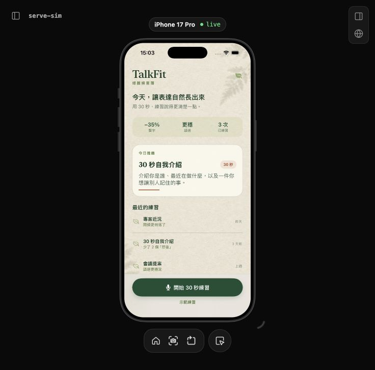
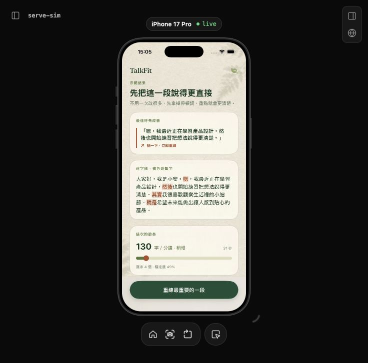
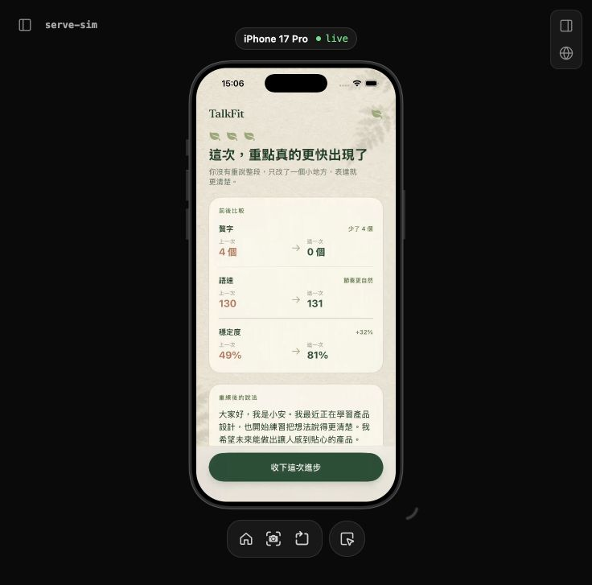
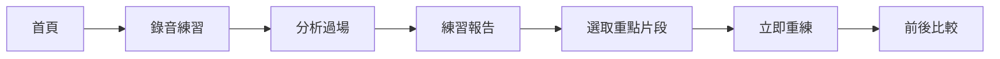

# TalkFit｜綠園練習簿

TalkFit 是一款溫暖、低壓力的私人表達教練。使用者可以在 2–3 分鐘內完成一段短講練習，查看逐字稿、贅字與語速問題，選出最值得改善的一小段立即重練，最後清楚比較前後進步。

目前版本是一個以 iOS 26 為目標的 SwiftUI MVP prototype，專注完成一條簡單、可靠又適合現場展示的核心體驗：

> 說完一段話後，TalkFit 找出最需要改善的片段，讓使用者立即重練，並清楚看見自己真的進步了。

## 畫面預覽

| 首頁 | 練習報告 | 前後比較 |
| --- | --- | --- |
|  |  |  |

## 核心流程



1. 首頁顯示固定推薦題目「30 秒自我介紹」、近期練習與成長摘要。
2. 使用麥克風錄下練習，畫面同步顯示計時器與即時音量波形。
3. 透過 Apple Speech framework 進行繁體中文逐字稿辨識。
4. 使用本機規則分析贅字、語速、表達穩定度與優先改善片段。
5. 直接重練最需要改善的一小段，不要求使用者重說整篇。
6. 以贅字數量、語速與穩定度呈現前後差異。

## 主要功能

### 真實錄音與 Apple 原生語音辨識

- 使用 `AVAudioEngine` 與 `AVAudioSession` 取得麥克風音訊。
- 使用 `SFSpeechRecognizer`，語系設定為 `zh-TW`。
- 支援辨識中的部分結果，逐步更新即時逐字稿。
- 裝置支援時優先要求 on-device speech recognition。
- 即時音量資料會驅動畫面中的簡易波形。

### 本機表達分析

TalkFit 不依賴後端或生成式 AI，而是使用可解釋、可重現的本機規則：

- 贅字清單：`嗯`、`呃`、`然後`、`就是`、`這個`、`那個`、`其實`、`對`。
- 贅字偵測：計算每個詞出現的次數，並在逐字稿中以陶土橘標示。
- 語速估算：以繁體中文及英數字元數除以錄音時間，換算成每分鐘字數。
- 穩定度：綜合贅字數量及語速與舒適區間的偏差計算。
- 優先片段：依片段中的贅字密度與句子長度評分，找出最值得先改善的一句。

### 穩定的示範備援

為了避免 Simulator、權限或語音服務狀況中斷核心流程，App 內建一致的示範結果：

- 首頁提供低調的「示範練習」入口。
- 麥克風權限被拒絕、語音辨識不可用或啟動失敗時，會自動切換示範模式。
- 逐字稿內容不足時才使用預先設計的範例結果。
- 如果已取得可用的真實逐字稿，會保留使用者實際說過的內容。
- 示範重練結果會明確呈現贅字下降與穩定度提升，確保完整流程不會停在死路。

## 視覺設計

介面延續「綠園練習簿」概念，以自然生長取代分數壓力：

- 帶有纖維質感的暖白紙張背景。
- 深松綠、苔綠與鼠尾草綠作為主要色彩。
- 陶土橘用於贅字、筆記線與需要注意的重點。
- 卡片採用練習簿紙張般的柔和邊界與留白。
- 全 App 使用一致的 26pt 頁面安全邊距與 20pt 卡片內距。
- 重要按鈕保留足夠觸控尺寸，並支援關鍵操作的 Accessibility Label／Identifier。
- 非必要動畫會尊重 Reduce Motion 設定。

## 技術組成

| 項目 | 使用技術 |
| --- | --- |
| UI | SwiftUI |
| 狀態管理 | Swift Observation、`@Observable` |
| 非同步流程 | Swift Concurrency、`async/await`、`Task` |
| 錄音 | AVFoundation、`AVAudioEngine` |
| 語音辨識 | Speech、`SFSpeechRecognizer` |
| 資料來源 | 記憶體內模型與集中式 fixtures |
| 後端 | 無 |
| 持久化 | 無 |

## 專案結構

```text
TalkFit/
├── TalkFitApp.swift            # App 進入點
├── ContentView.swift           # 首頁、錄音、報告、重練與比較畫面
├── TalkFitModel.swift          # 單一狀態來源與完整練習流程
├── TalkFitModels.swift         # Domain models、分析結果與示範資料
├── AudioSpeechService.swift    # 麥克風、音量與 Apple Speech 辨識
├── TalkFitTheme.swift          # 色彩、間距及共用 SwiftUI 元件
└── Assets.xcassets/            # App 圖像與紙張背景素材
```

## 執行環境

- macOS 與 Xcode 26 或更新版本。
- iOS 26.5 SDK。
- 專案基準裝置：iPhone 17 Pro。
- 真實語音路徑需要支援麥克風與 Apple Speech 的 iPhone。

## 開始使用

1. Clone Repo：

   ```bash
   git clone https://github.com/swiftruru/TalkFit.git
   cd TalkFit
   ```

2. 開啟 Xcode project：

   ```bash
   open TalkFit.xcodeproj
   ```

3. 在 Xcode 選擇 `TalkFit` scheme。
4. 選擇 iPhone 17 Pro Simulator 或支援 iOS 26.5 的實體 iPhone。
5. 按下 Run 執行。

專案沒有第三方套件，也不需要額外安裝 dependency。

## 權限說明

真實練習會要求以下系統權限：

- 麥克風：錄下使用者的短講練習並取得即時音量。
- 語音辨識：將繁體中文語音轉換成逐字稿。

對應的用途說明已設定於 Xcode build settings：

- `NSMicrophoneUsageDescription`
- `NSSpeechRecognitionUsageDescription`

使用者拒絕權限時不會卡住主要流程，App 會切換至示範備援。

## 如何體驗穩定 Demo

1. 在首頁點選「示範練習」。
2. 等待波形開始變化後，點選「說完了，看看回饋」。
3. 在報告選擇最值得改善的片段。
4. 點選「開始重練」。
5. 再次完成錄音，查看前後比較。

這條路徑不依賴 Simulator 麥克風或即時 Speech 服務，適合 hackathon 現場展示與作品集錄影。

## 驗證狀態

- 已於 iPhone 17 Pro Simulator（iOS 26.5）成功建置、安裝與啟動。
- 已完整操作示範流程：首頁 → 錄音 → 分析 → 報告 → 重練 → 前後比較 → 返回首頁。
- 已檢查語音辨識失敗時的 fallback，不會阻斷使用者流程。
- 主要畫面驗證證據位於 [`verification/`](verification/)；版面調整紀錄位於 [`verification/padding-audit/`](verification/padding-audit/)。

## 已知限制

- 目前沒有帳號、雲端同步、後端服務或練習資料持久化。
- 首頁的成長摘要與歷史項目是內建示範資料。
- Simulator 的麥克風與 Speech framework 行為可能依主機環境而異，正式裝置仍需重新確認權限與辨識品質。
- 目前只針對繁體中文自我介紹短講進行優化。

## 後續方向

- 在實體 iPhone 上進行不同環境噪音與說話距離測試。
- 增加更多短講題型與本機練習歷史。
- 改善片段切句與語速穩定度演算法。
- 補上單元測試與 UI 測試 target。
- 依實機測試結果調整 Dynamic Type 與橫向畫面體驗。

## 隱私

目前版本沒有後端，也不會將錄音或逐字稿上傳至 TalkFit 自有伺服器。語音辨識是否完全在裝置端執行，仍取決於裝置、系統版本與 Apple Speech framework 的可用能力。
