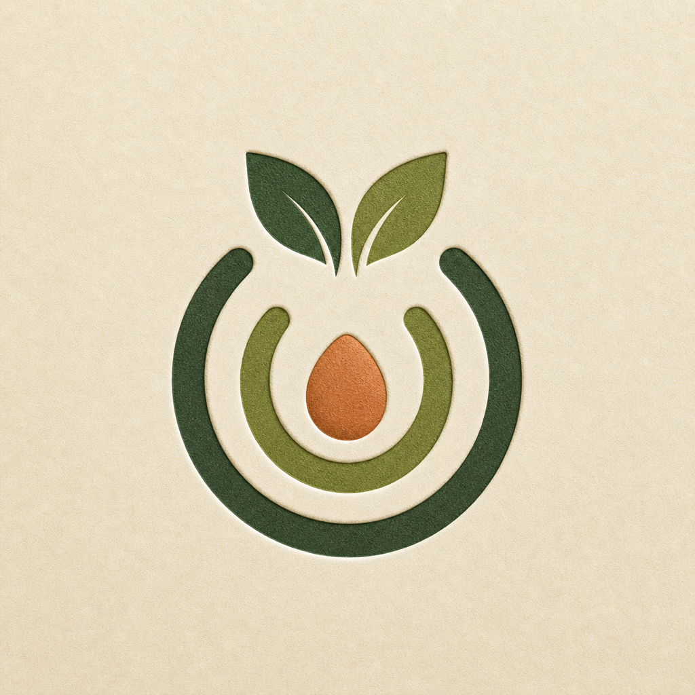
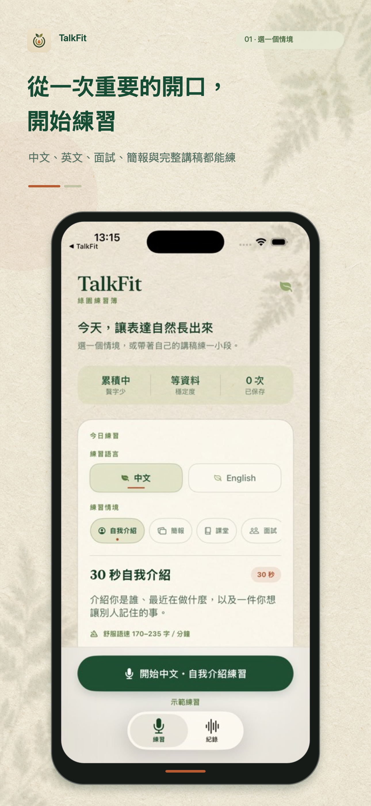
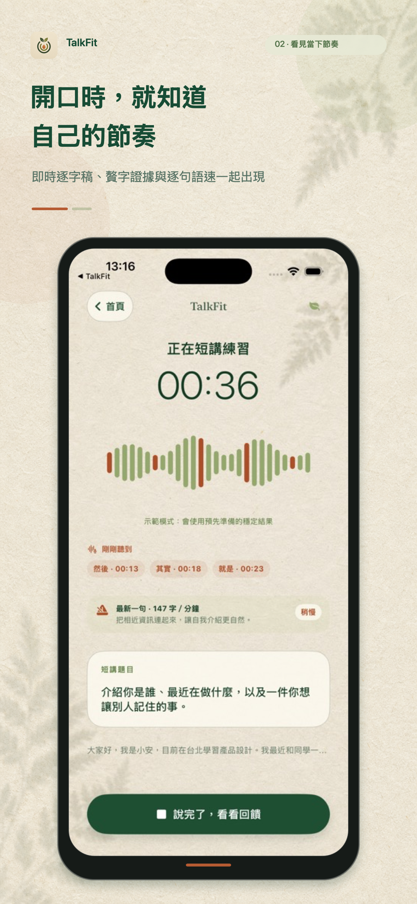
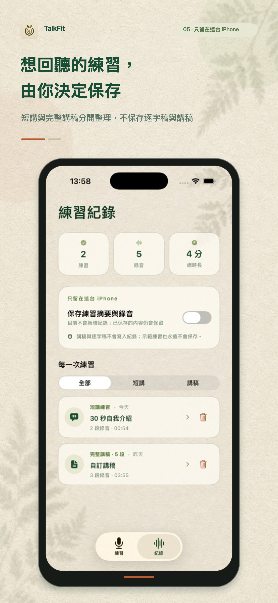

<div align="center">



# TalkFit 綠園練習簿

**讓每一次開口，都成為看得見的成長。**

繁體中文 ｜ [English](README.en.md)

<p>
  <a href="https://talkfit.sandy-domains.workers.dev/"></a>
  
  <a href="README.en.md"></a>
  
</p>

<p>
  
  
  
  
  
</p>

</div>

> 話說出口的那一刻，總還帶著一點不確定。  
> 嗯、然後、就是——那些停下來想的地方，  
> 是思緒還在路上，留下的腳印。  
> 把它們輕輕撿起來，再說一次，  
> 聲音就會慢慢長成你想要的樣子。

## 這是什麼

TalkFit 是一本放在口袋裡的練習簿，也是一位安靜、不催促的表達教練。

用繁體中文或英文說一段三十秒的話，它會替你把逐字稿攤開，圈出贅字，量一量每一句的快慢與句尾的停頓，然後只挑出**最值得先改的那一小段**，請你立刻再說一次。說完，前後兩次並排放著，進步不再只是感覺。

沒有分數排行，沒有帳號，也沒有後端。分析都在這台 iPhone 上完成；要不要把錄音留下來，由你決定。

- 產品網站：https://talkfit.sandy-domains.workers.dev/
- 完整的技術細節：[`docs/technical-notes.md`](docs/technical-notes.md)
- 之後想做的事：[`TODO.md`](TODO.md)

## 走一趟練習

<table>
  <tr>
    <th width="20%">01<br>選一個情境</th>
    <th width="20%">02<br>聽見當下的節奏</th>
    <th width="20%">03<br>只改最關鍵處</th>
    <th width="20%">04<br>看見真的進步</th>
    <th width="20%">05<br>只留在這台 iPhone</th>
  </tr>
  <tr>
    <td></td>
    <td></td>
    <td></td>
    <td></td>
    <td></td>
  </tr>
  <tr>
    <td valign="top">中文或英文；自我介紹、簡報、課堂報告、面試，或帶著自己的講稿來。</td>
    <td valign="top">開口的同時，波形跟著呼吸，語速與剛說出口的贅字就在眼前。</td>
    <td valign="top">不必整篇重來。先拿到一個清楚的順序，再練最要緊的那一句。</td>
    <td valign="top">贅字少了幾個，語速穩了多少，節奏的提醒有沒有變少，一眼看完。</td>
    <td valign="top">想回聽的練習才留下。隨時可以停止保存，也隨時可以刪掉。</td>
  </tr>
</table>

## 練習簿裡有什麼

**聽見寫得出來的贅字**
「然後」「就是」「其實」，或是 `like`、`you know`。逐字稿裡的贅字會被標成陶土橘，也可以在贅字庫裡加進自己的口頭禪。

**也聽見寫不出來的語氣聲**
語音辨識為了讓句子好讀，常常把「嗯」「呃」悄悄拿掉。TalkFit 另外直接聽錄音本身：持續零點四秒以上、音色幾乎不變的聲音，會被記成一次「語氣聲」，列在報告的「聲音裡還聽到」。它分不出那是「嗯」還是「呃」，所以不替你猜。

**跟著時鐘走的語速**
錄音時，語速是用最近幾秒實際說出的字數算的；錄完之後，再依每個字的時間，一句一句量。每個情境有自己的舒服區間，例如中文自我介紹是每分鐘 170 到 260 字。朗讀本來就比即興快一些，所以要明顯超過，才會提醒你慢下來。

**句尾的半拍**
句子之間停得太短、太長，或是突然加速，都會留下一則簡短的提醒，告訴你下一次可以在哪裡換氣。

**兩種範例講稿**
每個情境都有一份照著唸的講稿，分成「正常版」與「贅字版」。贅字版裡故意放了四個贅字，並用橘色標出來。唸一次，看看 TalkFit 抓到幾個。

**自己的講稿**
貼上完整的講稿，先從頭說一遍；之後每一段都有各自的建議，可以只挑一段加強。報告會提醒哪些關鍵詞沒說到，但不要求你一字不差。

**不冒充你的示範**
麥克風或語音辨識不能用的時候，App 會明白告訴你，而不是悄悄換成範例內容。示範練習要你自己選，而且永遠不會被存成你的紀錄。

**看得見的累積**
同一個題目練滿三次，會長出一張趨勢圖：贅字、語速與穩定度，一次一次往哪裡走。

## 圖示裡的小種子

App 圖示把「聲音的漣漪」與「嫩芽的生長」收在同一個符號裡。

- **向外展開的綠色弧線**：開口、被聽見、得到回饋、再說一次。
- **中央的陶土色種子**：每一次還不完美，但願意說出口的開始。
- **頂端的兩片嫩葉**：重練之前與之後，不是比較，而是一起證明你長大了一點。
- **暖白的紙張**：一本只有你會翻開的練習簿。

## 用什麼做的

<p>


</p>

iOS App 沒有任何第三方套件。規則都是看得懂、重跑會得到相同結果的本機運算，沒有生成式 AI，也沒有伺服器。

```text
TalkFit/                          iOS App
  TalkFitModel.swift              單一狀態來源：首頁 → 錄音 → 分析 → 報告 → 重練 → 比較
  AudioSpeechService.swift        麥克風、音量、逐字稿與贅字證據
  HesitationSoundDetector.swift   從錄音訊號找出語氣聲
  LivePaceEstimator.swift         錄音中依時鐘估算語速
  TalkFitAnalyzer.swift           贅字、語速、節奏、穩定度與優先片段
  TranscriptSentenceSegmenter.swift  依標點與停頓切句
  PracticeContext.swift           四種情境的題目、範例講稿與舒服語速
  ReferenceScript.swift           正常版與贅字版講稿的切換
  ScriptPractice.swift            自訂講稿的分段與內容涵蓋
  PracticeHistoryStore.swift      練習摘要（SwiftData）
  RecordingArchiveStore.swift     使用者選擇保存的錄音
TalkFitTests/                     61 個單元測試（Swift Testing）
TalkFitWidget/                    主畫面小工具
website/                          產品網站（Next.js、vinext、Cloudflare Workers）
docs/readme/                      這份 README 的徽章與產生腳本
```

## 開始使用

需要 macOS、Xcode 26 以上，以及 iOS 26.5 的模擬器或實機。

```bash
git clone https://github.com/swiftruru/TalkFit.git
cd TalkFit
open TalkFit.xcodeproj
```

選擇 `TalkFit` scheme，挑一台 iPhone，按下 Run。

真實練習會請求麥克風與語音辨識兩項權限。拒絕也沒關係，App 會說明原因，並讓你選擇重新錄音或改用示範練習。

### 先試試示範練習

不需要麥克風，適合現場展示：

1. 在首頁選語言與情境，點「示範練習」。
2. 等波形動起來，點「說完了，看看回饋」。
3. 在報告裡選擇重錄最值得改善的那一段。
4. 再說一次，看前後比較。

### 產品網站

```bash
cd website
npm install
npm run dev
```

更多說明在 [`website/README.md`](website/README.md)。

## 隱私

錄音與逐字稿不會離開這台 iPhone 去到 TalkFit 的伺服器，因為 TalkFit 沒有伺服器。

只有在你打開保存之後，App 才會留下日期、語言、前後的指標摘要，以及你的錄音。講稿、逐字稿與逐句內容不會寫進紀錄；示範練習永遠不會被保存。語音辨識是否完全在裝置上進行，取決於裝置、系統版本與 Apple Speech 的支援情況。

## 還在長的地方

- 語氣聲的門檻目前只用少量真實錄音校正過；短於零點四秒的「嗯」會被放過，拖得很長的尾音則可能被算進去。
- 舒服語速的區間是一般口說練習的經驗值，尚未用大量不同年齡與口音的樣本校正。
- 練習紀錄只在這台裝置上，不會跨裝置同步。
- 介面目前是繁體中文；「English」指的是口說與辨識的語言。
- 這些回饋是口說練習的參考，不是醫療評估、診斷或治療建議。

完整的清單與驗證紀錄，收在 [`docs/technical-notes.md`](docs/technical-notes.md)。

<div align="center">

<p>
  
  
</p>

願你下一次開口，比這一次更像自己。

</div>
