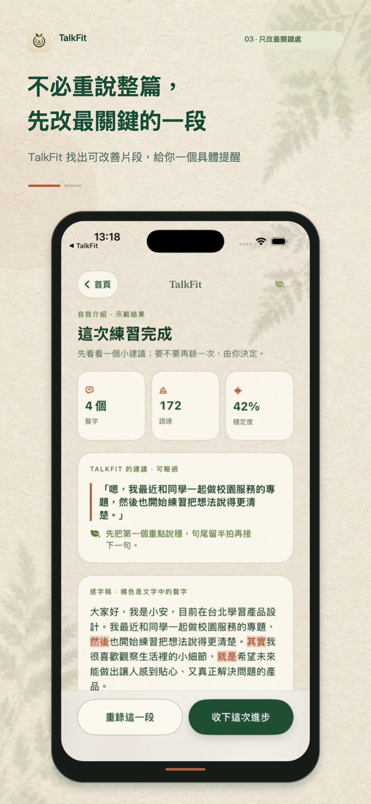
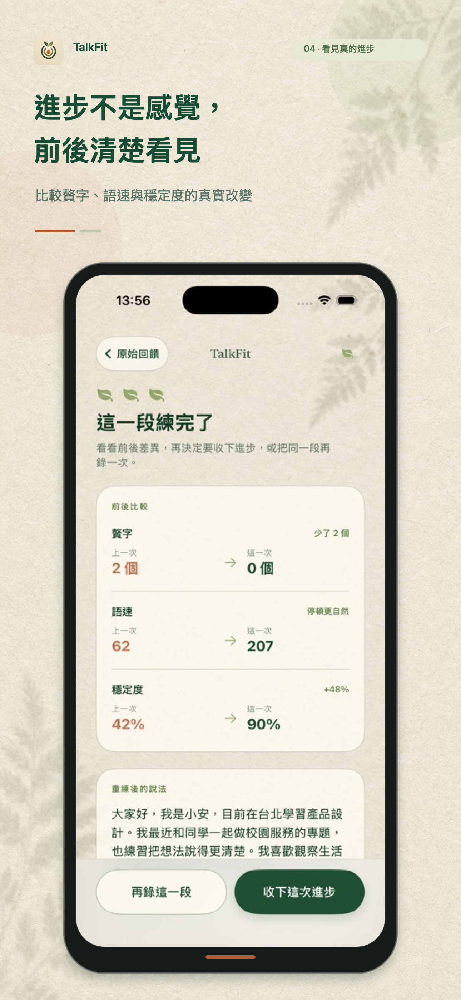

<p align="center">
  
</p>

<h1 align="center">TalkFit｜綠園練習簿</h1>

<p align="center">
  <strong>讓每一次開口，都成為看得見的成長。</strong><br>
  一位溫暖、低壓力，陪你立即重練的私人表達教練。
</p>

<p align="center">
  
  
  
  
  
  
  
  
  <a href="https://github.com/swiftruru/TalkFit/stargazers"></a>
  <a href="https://github.com/swiftruru/TalkFit/forks"></a>
</p>

## App Icon 設計理念

TalkFit 的 icon 把「**聲音的漣漪**」與「**嫩芽的生長**」收進同一個安靜、容易辨識的符號裡。它不是分數或獎盃，而是一段聲音被好好接住之後，逐漸長出自信的樣子。

- **同心聲音波紋**：兩道由內向外展開的綠色弧線，代表開口、聆聽、回饋與再次練習的循環，也呼應 TalkFit 最重要的「立即重練」體驗。
- **中央陶土種子**：橘棕色種子象徵每一次還不完美、但願意說出口的開始；溫暖的小面積色彩，也讓圖示在自然綠之中保有清楚焦點。
- **頂端雙葉嫩芽**：兩片葉子代表表達能力透過練習持續生長，也像重練前與重練後的兩個狀態——不是彼此競爭，而是一起證明進步。
- **暖白纖維紙張**：背景延續「綠園練習簿」的觸感，傳達私密、安心與低壓力的練習空間，避免傳統語言工具常見的冰冷科技感。
- **松綠、苔綠與陶土橘**：自然色彩建立沉靜、可信任的品牌氣質；柔和壓紋與簡潔輪廓則兼顧 Apple 平台的精緻感，以及縮小到主畫面後的辨識度。

這個圖示濃縮了 TalkFit 的核心承諾：**聲音不需要一次完美，只要願意再次練習，就會慢慢長成自己的樣子。**

## 關於 TalkFit

TalkFit 是一款溫暖、低壓力的私人表達教練。使用者可以用繁體中文或英文，在 2–3 分鐘內完成一段短講練習，查看逐字稿、贅字、逐句語速與停頓節奏問題，選出最值得改善的一小段立即重練，最後清楚比較前後進步。

目前版本是一個以 iOS 26 為目標的 SwiftUI MVP prototype，專注完成一條簡單、可靠又適合現場展示的核心體驗：

> 說完一段話後，TalkFit 找出最需要改善的片段，讓使用者立即重練，並清楚看見自己真的進步了。

此 repository 也包含 `website/` 官方產品網站，提供產品介紹、TestFlight 候補名單、支援中心、隱私權政策與使用條款。

## TalkFit 體驗一覽

<p align="center">
  <strong>找到最值得改善的一小段，立即重練，親眼看見自己真的進步。</strong><br>
  從第一次開口到保存成長，TalkFit 把完整練習收進一條安靜、清楚的路徑。
</p>

<p align="center">
  <a href="https://talkfit.sandy-domains.workers.dev/">瀏覽 TalkFit 官方產品網站</a>
</p>

<table>
  <tr>
    <td width="20%" align="center"><strong>01<br>選一個情境</strong></td>
    <td width="20%" align="center"><strong>02<br>看見當下節奏</strong></td>
    <td width="20%" align="center"><strong>03<br>只改最關鍵處</strong></td>
    <td width="20%" align="center"><strong>04<br>看見真的進步</strong></td>
    <td width="20%" align="center"><strong>05<br>只留在這台 iPhone</strong></td>
  </tr>
  <tr>
    <td></td>
    <td></td>
    <td></td>
    <td></td>
    <td></td>
  </tr>
  <tr>
    <td valign="top">選擇中文或英文，以及自我介紹、簡報、課堂報告、面試或完整講稿。</td>
    <td valign="top">錄音時同步掌握逐字稿、真實音量、贅字線索與最新一句語速。</td>
    <td valign="top">不重說整篇；先取得一個清楚優先順序，再重練最重要的一段。</td>
    <td valign="top">用贅字、語速、節奏提醒與穩定度，比較前後真正的改變。</td>
    <td valign="top">可選擇把摘要與真實錄音留在裝置，隨時回聽、停止保存或刪除。</td>
  </tr>
</table>

## 核心流程

1. 首頁可選擇自我介紹、簡報、課堂報告或面試回答，也能貼上自己的講稿並選一段練習；畫面同時顯示舒服語速、近期練習與成長摘要。
2. 使用麥克風錄下練習，畫面同步顯示計時器與即時音量波形。
3. 透過 Apple Speech framework 進行繁體中文或英文逐字稿辨識。
4. 使用本機規則分析贅字、語速、句尾停頓、突然加速、表達穩定度與優先改善片段；講稿模式另外比較內容涵蓋與可補回的關鍵詞。
5. 直接重練最需要改善的一小段，不要求使用者重說整篇。
6. 以贅字數量、語速與穩定度呈現前後差異。
7. 在錄音、分析、報告、重練與比較頁提供符合情境的返回路徑，可能遺失資料時會先顯示確認提示。
8. 完成真實練習時，由使用者決定是否只在本機保存進步摘要與真實錄音；講稿、逐字稿、逐句內容與贅字時間戳不會寫入紀錄。

## 主要功能

### 真實錄音與 Apple 原生語音辨識

- 使用 `AVAudioEngine` 與 `AVAudioSession` 取得麥克風音訊。
- 使用 `SFSpeechRecognizer`，依首頁選擇切換 `zh-TW` 或 `en-US`。
- Apple 最終逐字稿負責顯示可讀文字；partial results、候選辨識與 segment 時間戳則另外保存為贅字證據。
- 支援辨識中的部分結果，逐步更新即時逐字稿與「剛剛聽到」的贅字提示。
- 停止錄音後會等待 Apple Speech 的 final result，最長保留 4 秒安全上限；若 final 仍為空但已有可用 partial 文字，會保留使用者實際說過的內容。
- 真實逐字稿即使很短也不會被示範內容取代；完全沒有辨識文字時會進入安全提示畫面，讓使用者重新錄音或主動改用示範練習。
- 裝置支援時優先要求 on-device speech recognition。
- 透過 `contextualStrings` 提示常見贅字，並預先準備繁體中文自訂 Speech language model，提高「嗯」「呃」等短語氣聲的辨識機會。
- 即時音量資料會驅動畫面中的簡易波形。

### 中英文與練習情境

- 首頁將語言、練習情境、推薦題目與贅字庫整合在同一張「今日練習」紙張卡片，避免設定區塊打斷主要練習動線。
- 可透過綠園主題的雙書籤選擇器在「中文」與 `English` 間切換；選取狀態使用鼠尾草綠紙張、葉片記號與陶土色底線，而不是系統預設 segmented control。
- 情境列提供自我介紹、簡報、課堂報告與面試回答四種選項；採可水平滑動的紙張標籤，在大字體下仍可完整操作。
- 切換語言或情境後，推薦題目、主要 CTA、示範逐字稿、Speech contextual hints、歷史分組與語速建議會同步更新。
- 每個情境有獨立的中英文舒服語速區間與具體提醒；例如面試會優先提示先說行動與結果，簡報則提醒觀眾是否跟得上重點。
- 中文以「字／分鐘」計算；英文以「詞／分鐘」計算。
- 錄音時顯示最新一句的語速與一個簡短建議，完成後則在報告列出每一句的語速狀態。
- 目前介面語言仍為繁體中文；英文選項指的是口說內容與辨識語言。

### 自訂講稿分段練習

- 從首頁開啟「練自己的講稿」，貼上內容後以空白行分段；沒有空白行時也能依逐行內容拆段。
- 可預覽並選擇這次要練的段落，首頁題目與主要 CTA 會同步改成「講稿第 N 段」。
- 選取段落會加入 Apple Speech contextual hints，協助專有名詞與講稿內容辨識；辨識結果仍以使用者實際說出的文字為準。
- 報告以可解釋的本機字詞涵蓋規則顯示「內容涵蓋」百分比，並列出最多三個可補回的關鍵詞；不要求逐字背誦，也不把它包裝成語意正確率。
- 講稿只存在目前 App 使用期間。歷史若已開啟，會保存「自訂講稿」、前後指標與這次的真實錄音，但不會寫入講稿原文、逐字稿、逐句內容或贅字時間戳。
- 示範／語音辨識備援會從使用者選取的段落生成一致結果，不會突然換成無關的預設自我介紹。

### 動態贅字庫

- 中文與英文各自擁有獨立預設贅字庫。
- 使用者可從首頁開啟贅字庫，新增自己的口頭習慣或刪除不需要的詞。
- 更新會立即套用到下一次 Apple Speech contextual hints、自訂 language model 與本機分析。
- 自訂內容會保存在使用者裝置；App 只記錄相對於內建詞庫的新增與移除差異，內建預設更新時仍能自然合併。
- 可單獨還原目前語言，或一次還原中文與英文；執行前會以原生確認提示避免誤觸。

### 贅字雙軌辨識

Apple Speech 可能會為了讓句子更易讀，在最終逐字稿中省略「嗯」「呃」等語氣聲。TalkFit 因此不再只依賴最終文字，而是將資料分成兩條軌道：

1. **可讀逐字稿**：使用 Apple 的 best transcription，作為使用者最後看到的正文。
2. **贅字證據**：持續蒐集 partial result、alternative transcription、segment timestamp 與 confidence；即使最終正文省略語氣聲，仍可納入統計。

同一個贅字在相近時間出現時會去重，並依 final、partial、alternative 的可靠度保留較佳證據。報告中若有「文字沒有顯示、但聲音證據曾捕捉」的贅字，會另外列在「聲音裡還聽到」區塊，而不是硬塞回 Apple 的可讀逐字稿。

### 本機表達分析

TalkFit 不依賴後端或生成式 AI，而是使用可解釋、可重現的本機規則：

- 中文預設贅字：`嗯`、`呃`、`然後`、`就是`、`這個`、`那個`、`其實`、`對`。
- 英文預設贅字：`um`、`uh`、`like`、`you know`、`actually`、`basically`、`so`、`right`。
- 贅字偵測：計算每個詞出現的次數，並在逐字稿中以陶土橘標示。
- 語速估算：中文以可讀字元、英文以單字數除以錄音時間，換算成每分鐘單位。
- 逐句語速：優先使用 Apple Speech segment timestamp、duration 與句間停頓；缺少時間片段時才按句子長度估算。
- 句尾停頓：相鄰 Speech segments 的時間差小於 0.35 秒會提示「太短」、0.35–1.25 秒視為自然停頓、超過 1.25 秒則提示「稍長」。
- 突然加速：比較相鄰句子的語速；中文至少增加 45 字／分鐘、英文至少增加 30 詞／分鐘，且快於前句 28% 以上時才標記，避免一般波動造成干擾。
- 穩定切句：有標點時依自然句尾切分；無標點 partial result 則依明顯停頓、連接詞與長度上限拆成可讀的小段。
- 中英混合：中文模式中的完整英文單字與小數會保留為一個語速單位，不會把 `TalkFit` 拆成七個字母計算。
- 穩定度：綜合贅字數量、語速與舒適區間的偏差、停頓過短／過長及突然加速計算。
- 優先片段：比較可讀逐字稿與保留贅字較完整的分析文本，依贅字密度與句子長度找出最值得先改善的一句。
- 講稿內容涵蓋：中文使用字元與混合英文單字、英文使用完整單字做多重集合比對；多說的內容不扣分，缺少的內容才會形成補充提示。

### 穩定且不冒充真實內容的示範備援

為了避免 Simulator、權限或語音服務狀況中斷核心流程，App 內建一致的示範結果：

- 首頁提供低調的「示範練習」入口。
- 麥克風權限被拒絕、語音辨識不可用、啟動失敗或完全沒有逐字稿時，會顯示明確的安全畫面，不會直接產生「小安」範例報告。
- 安全畫面提供「重新錄音」與「改用示範練習」；只有使用者主動選擇後，App 才會載入預先設計的範例結果。
- 短逐字稿與可用的 partial 結果會保留為真實練習，不再因字數門檻被換成範例。
- 講稿模式的 fallback 會沿用選取段落，並依段落長度估算示範時長，避免短句被固定秒數誤判成極慢。
- 如果已取得可用的真實逐字稿，會保留使用者實際說過的內容。
- 示範重練結果會明確呈現贅字下降與穩定度提升，確保完整流程不會停在死路。
- 第一次示範刻意包含過短停頓、較長停頓與突然加速；重練後改為自然句尾停頓，前後比較會顯示減少的節奏提醒數量。

### 可選擇開啟的本機練習摘要與錄音紀錄

- 歷史紀錄預設關閉；第一次完成真實練習並按下「收下這次進步」時，App 才會清楚詢問是否開啟。
- 使用 SwiftData 保存完成日期、練習語言、題目識別與前後的贅字數、語速、穩定度、節奏提醒數；真實音檔則只留在 App 的本機資料目錄。
- 自訂講稿以固定識別 `custom-script` 與「自訂講稿」標題保存，不保存段落原文。
- 只有使用者主動開啟保存後，才會留下真實練習錄音；不保存講稿、逐字稿、逐句內容、贅字詞彙或時間戳。
- 首頁的成長摘要與最近三筆會改用真實保存資料，不再顯示預設假歷史；資料不足時顯示「累積中」。
- 可從首頁進入本機紀錄，分開管理短講與完整講稿、回聽每次錄音，並隨時停止新增紀錄、刪除單筆或清除全部。
- 示範模式、權限失敗或辨識 fallback 產生的範例結果不會寫入歷史，避免把展示資料誤當成個人成長。
- 相同題目與語言累積至少 3 次後，使用 Swift Charts 顯示重練後的贅字、語速與穩定度長期變化。
- 語速趨勢比較的是「離舒服區間的距離」，不會把越快誤判成越好；未滿 3 次時只顯示低壓力的葉片累積進度。

## 視覺設計

介面延續「綠園練習簿」概念，以自然生長取代分數壓力：

- 帶有纖維質感的暖白紙張背景。
- 深松綠、苔綠與鼠尾草綠作為主要色彩。
- 陶土橘用於贅字、筆記線與需要注意的重點。
- 卡片採用練習簿紙張般的柔和邊界與留白。
- 首頁把語言選擇、推薦題目與贅字庫收進同一張練習紙，讓設定成為開始練習前的自然一步，而不是突兀的系統控制面板。
- 語言選擇器保留至少 44pt 的觸控高度，並以葉片、紙張層次和陶土色短線清楚呈現目前選項。
- 全 App 使用一致的 26pt 頁面安全邊距與 20pt 卡片內距。
- 重要按鈕保留足夠觸控尺寸，並支援關鍵操作的 Accessibility Label／Identifier。
- 內頁使用一致的綠園主題返回列：紙張色膠囊、松綠返回文字、中央品牌字樣與葉片記號。
- 返回動作會依資料風險分級：不會遺失內容時直接返回；錄音、分析、未完成回饋或比較結果可能消失時，使用原生 SwiftUI confirmation alert 防止誤按。
- 非必要動畫會尊重 Reduce Motion 設定。

## 技術組成

| 項目 | 使用技術 |
| --- | --- |
| UI | SwiftUI |
| 狀態管理 | Swift Observation、`@Observable` |
| 非同步流程 | Swift Concurrency、`async/await`、`Task` |
| 圖表 | Swift Charts、`LineMark`、`PointMark`、`RuleMark` |
| 測試 | Swift Testing、iOS Simulator unit test target |
| 錄音 | AVFoundation、`AVAudioEngine` |
| 語音辨識 | Speech、`SFSpeechRecognizer` |
| 資料來源 | 單一 Observation 狀態、集中式 fixtures、裝置端偏好、本機練習摘要與錄音紀錄 |
| App 後端 | 無；核心分析、練習摘要與選擇保存的錄音均留在裝置端 |
| 持久化 | SwiftData（練習摘要與錄音索引）、本機音檔、`UserDefaults`（贅字庫差異與保存開關） |
| 官方網站 | Next.js 16 App Router、React 19、TypeScript、vinext、Vite |
| 網站執行環境 | Cloudflare Workers；表單目前為無 D1 的非持久化展示 |

## 專案結構

```text
TalkFit/
├── TalkFitApp.swift            # App 進入點
├── ContentView.swift           # 錄音、報告、重練與比較流程
├── HomeView.swift              # 主題式語言／情境選擇、推薦題目與近期練習
├── ScriptPracticeView.swift    # 講稿貼上、隱私說明與段落選擇介面
├── ScriptPractice.swift        # 講稿分段、內容涵蓋與缺漏關鍵詞規則
├── FillerLibraryView.swift     # 動態贅字庫編輯與還原確認介面
├── FillerLibraryStore.swift    # 裝置端贅字庫差異式持久化
├── PracticeHistoryView.swift   # 歷史隱私開關、紀錄列表與刪除介面
├── PracticeHistoryStore.swift  # SwiftData 摘要模型與最小化儲存規則
├── PracticeTrend.swift         # 趨勢分組、進度與指標變化規則
├── PracticeLanguage.swift      # 語言、贅字與 Speech segment models
├── PracticeContext.swift       # 四種情境、中英文題目、示範內容與舒服語速規則
├── TranscriptSentenceSegmenter.swift # 標點、停頓與混合語言切句規則
├── PaceFeedbackViews.swift     # 錄音中及報告後的逐句語速元件
├── TalkFitModel.swift          # 單一狀態來源與完整練習流程
├── TalkFitModels.swift         # Domain models、Speech capture、分析結果與示範資料
├── TalkFitAnalyzer.swift       # 贅字、語速、穩定度與優先片段的本機規則
├── AudioSpeechService.swift    # 麥克風、音量、逐字稿與贅字證據蒐集
├── FillerEvidenceReducer.swift # partial／候選／最終贅字證據去重
├── FillerLanguageModel.swift   # Apple Speech 自訂繁體中文贅字語言模型
├── TalkFitTheme.swift          # 色彩、間距、返回列及共用 SwiftUI 元件
└── Assets.xcassets/            # App 圖像與紙張背景素材

TalkFitTests/
├── TalkFitAnalyzerTests.swift       # 切句、語速、字界與贅字證據單元測試
├── PracticeHistoryStoreTests.swift  # 記憶體內 SwiftData 隱私與刪除測試
├── PracticeTrendTests.swift         # 趨勢門檻、分組、排序與指標測試
├── PracticeContextTests.swift       # 情境題目、語速分類、Speech hints 與示範改善測試
└── ScriptPracticeTests.swift        # 講稿分段、雙語涵蓋、隱私與穩定備援測試

website/
├── app/                         # Next.js App Router 頁面、元件與 API routes
├── db/                          # D1 連線與 Drizzle schema
├── drizzle/                     # D1 database migrations
├── public/                      # 網站圖片、icon 與社群分享素材
├── tests/                       # 建置後 HTML 驗證
├── worker/                      # Cloudflare Worker entry point
├── package.json                 # 網站 scripts 與 dependency 版本
└── vite.config.ts               # vinext、Vite 與 Cloudflare 整合設定
```

## 執行環境

- macOS 與 Xcode 26 或更新版本。
- iOS 26.5 SDK。
- 專案基準裝置：iPhone 17 Pro。
- 真實語音路徑需要支援麥克風與 Apple Speech 的 iPhone。
- 官方網站需要 Node.js 22.13.0 或更新版本。

## 開始使用

1. Clone Repo：

   ```bash
   git clone https://github.com/swiftruru/TalkFit.git
   cd TalkFit
   ```

2. 開啟 Xcode project：

   ```bash
   open TalkFit.xcodeproj
   ```

3. 在 Xcode 選擇 `TalkFit` scheme。
4. 選擇 iPhone 17 Pro Simulator 或支援 iOS 26.5 的實體 iPhone。
5. 按下 Run 執行。

iOS App 沒有第三方套件，不需要額外安裝 dependency。

### 執行官方網站

```bash
cd website
npm install
npm run dev
```

網站以 vinext 使用 Next.js App Router API，並透過 Vite 與 Cloudflare Worker 執行。常用指令：

```bash
npm run lint
npm test
npm run build
```

目前 TestFlight 與隱私表單只是前端展示，不會傳送或儲存輸入內容，也不需要 Cloudflare D1。請勿將 `.env*` 或憑證提交進 repository。更多網站說明見 [`website/README.md`](website/README.md)。

## 權限說明

真實練習會要求以下系統權限：

- 麥克風：錄下使用者的短講練習並取得即時音量。
- 語音辨識：將繁體中文語音轉換成逐字稿。

對應的用途說明已設定於 Xcode build settings：

- `NSMicrophoneUsageDescription`
- `NSSpeechRecognitionUsageDescription`

使用者拒絕權限時不會卡住主要流程；App 會清楚說明辨識未開始，並讓使用者選擇重新錄音或主動進入示範備援。

## 如何體驗穩定 Demo

1. 在首頁選擇「中文」或 `English`，再選擇一個練習情境並點選「示範練習」。
2. 等待波形開始變化後，點選「說完了，看看回饋」。
3. 在報告選擇最值得改善的片段。
4. 點選「開始重練」。
5. 再次完成錄音，查看前後比較。

這條路徑不依賴 Simulator 麥克風或即時 Speech 服務，適合 hackathon 現場展示與作品集錄影。

若要體驗講稿模式，先在首頁開啟「練自己的講稿」，貼上至少一段內容並選取段落；再切換對應口說語言後使用「示範練習」，即可穩定查看講稿對照與前後進步。

## 驗證狀態

- 已於 iPhone 17 Pro Simulator（iOS 26.5）成功建置、安裝與啟動。
- 已完整操作示範流程：首頁 → 錄音 → 分析 → 報告 → 重練 → 前後比較 → 返回首頁。
- 已撤銷 Simulator 麥克風權限檢查語音辨識失敗流程；畫面會提供重新錄音與主動示範選項，不會將真實錄音替換成「小安」報告。
- 已逐頁檢查返回行為：錄音與分析可安全取消、重練準備可返回原始回饋、比較頁可返回原始報告。
- 已驗證重要返回動作會顯示資料遺失提示；分析進行中的確認窗會暫停自動跳轉，避免提示後方畫面改變。
- 已確認返回按鈕至少保留 44pt 觸控區域，並提供 VoiceOver label／hint。
- 已操作中文與英文示範流程，確認題目、逐字稿、贅字、語速單位、逐句建議、重練與比較會跟隨所選語言。
- 已確認首頁的主題式語言選擇器可正確切換中英文，並同步更新題目、CTA 與 VoiceOver 選取狀態。
- 已逐一切換自我介紹、簡報、課堂報告與面試回答，確認中英文題目、情境式 Speech hints、舒服語速與 CTA 同步更新。
- 已完整操作英文面試示範流程；報告保留聲音裡的 `um` 證據，重練後顯示贅字 2→0、語速 72→76 詞／分鐘、穩定度 44%→75%。
- 已在 serve-sim 的 iPhone 17 Pro 以英文自訂講稿完成：貼上兩段內容 → 預覽分段 → 選段 → 示範錄音 → 講稿對照 → 重練 → 前後比較。
- 已確認講稿報告顯示 100% 內容涵蓋與原文展開入口；修正短句備援後，前後比較顯示贅字 1→0、語速維持 135 詞／分鐘、穩定度 83%→91%。
- 已確認自訂講稿歷史測試只保存 `custom-script` 與「自訂講稿」，不含測試中的私人原文。
- 已將首頁文字尺寸提高至大字體檢查情境列；可水平滑動選取最右側面試，題目內容可垂直捲動，固定底部 CTA 保持可用。
- 已在本機歷史管理頁開啟摘要保存，關閉並重新啟動 App 後確認選擇仍保留。
- 已完成整條示範流程並按下「收下這次進步」，確認示範結果不會新增歷史，首頁仍為 0 次。
- 已在 serve-sim 將文字尺寸提高至大字體檢查本機歷史頁；隱私說明、開關與空狀態仍可完整閱讀，內容可捲動。
- 已驗證 0 次時顯示「完成 3 次，看見變化」累積狀態，不會用不足的資料臆測趨勢。
- 已以隔離的記憶體資料在 serve-sim 檢查 4 次練習的完整 Swift Charts 趨勢卡；贅字下降、語速進入舒服區間、穩定度上升與最近三筆列表均正確顯示。
- 已以大字體捲動完整趨勢卡與歷史列表，圖表、指標、日期、刪除操作與固定導覽列皆保持可用。
- 已使用最大 Dynamic Type 檢查首頁；推薦題目、贅字庫與最近練習可透過捲動完整閱讀，固定底部 CTA 不會阻斷操作。
- 已在報告逐句確認短停頓、長停頓與突然加速提示，並驗證重練比較可顯示減少的節奏提醒。
- 已以最大 Dynamic Type 檢查節奏摘要、逐句提示與前後比較，內容可捲動且底部操作保持可用。
- 已在英文贅字庫新增自訂詞並確認數量立即更新。
- 已關閉並重新啟動 App，確認英文自訂贅字仍保留於裝置。
- 已驗證單一語言還原，以及同時清除中英文自訂差異的「還原所有語言」流程與確認提示。
- 已加入並執行 43 個本機單元測試；除了原有的切句、語速、節奏與贅字證據，也涵蓋真實逐字稿不可被示範內容覆蓋、partial 文字保留、本機歷史隱私、錄音匯入與刪除、示範結果排除、趨勢分組、四種情境，以及講稿分段、雙語內容涵蓋、講稿歷史最小化與穩定備援。
- 主要畫面驗證證據位於 [`verification/`](verification/)；版面調整紀錄位於 [`verification/padding-audit/`](verification/padding-audit/)。

## 已知限制

- 目前沒有帳號、雲端同步或後端服務；練習歷史只存在目前裝置。
- 本機紀錄可回聽使用者主動保存的真實錄音，但不保存逐字稿與完整報告，因此不能從紀錄重建當時的逐句分析畫面。
- 趨勢至少需要 3 次相同題目與語言；目前尚未提供週／月篩選、趨勢區間切換或跨題目比較。
- 關閉「保存練習摘要與錄音」只會停止新增，不會自行刪除既有資料；使用者需明確選擇單筆刪除或全部清除。
- 自訂贅字庫只保存在目前裝置，不會跨裝置同步。
- Simulator 的麥克風與 Speech framework 行為可能依主機環境而異，正式裝置仍需重新確認權限與辨識品質。
- Apple Speech 仍可能完全忽略非常短、音量較低或與前後字黏在一起的語氣聲；partial／候選證據、自訂 language model 與 contextual hints 能改善蒐集機會，但無法保證捕捉每一次贅字。
- 自訂 Speech language model 是否生效取決於系統與裝置的 on-device recognition 支援狀況；不可用時會退回 contextual hints 與既有分析，完全無法辨識時則由使用者決定是否改用示範備援。
- 目前提供繁體中文與英文的 30 秒情境題目與自訂講稿單段練習；尚未提供每段完成進度、跨段統計、1／3 分鐘或自訂時間。
- 講稿「內容涵蓋」是本機字詞比對，不理解同義詞、改寫或語意等價；適合提醒可能漏掉的內容，不應視為正確率或評分。
- 講稿分段目前最多取前 30 段，並只存在目前 App 使用期間；尚未提供文件匯入、講稿命名或跨次保存。
- 情境語速區間是一般口說產品規則，尚未經大量真機樣本或不同年齡、口音與專業情境校正。
- 無標點切句使用可解釋的停頓與長度規則；非常長的專有名詞或特殊口語結構仍需更多真機樣本校正。
- 節奏分析依賴 Apple Speech 提供的 segment timestamp 與 duration；辨識片段不足時只顯示逐句語速，不會臆測句尾停頓。現有停頓與加速門檻屬一般口說規則，仍需真機樣本校正。
- 語速區間與逐句建議是一般口說練習用的產品規則，不是醫療評估、診斷或治療建議。

## 後續方向

完整、可勾選的分階段規劃請見 [`TODO.md`](TODO.md)。醫療／正音方向被獨立列為 Medical Track，需有語言治療專業、臨床、隱私與法規驗證後才會進入產品功能。

- 在實體 iPhone 上進行不同環境噪音與說話距離測試。
- 依真機錄音樣本調整贅字證據去重時間窗、confidence 門檻與自訂語言模型權重。
- 增加更多短講題型、練習時間與自訂題目。
- 改善片段切句與語速穩定度演算法。
- 補上單元測試與 UI 測試 target。
- 依實機測試結果調整 Dynamic Type 與橫向畫面體驗。

## 隱私

iOS App 沒有 TalkFit 自有後端，也不會將錄音或逐字稿上傳至 TalkFit 自有伺服器。只有使用者主動開啟保存後，App 才會在這台 iPhone 留下日期、語言、前後指標摘要與真實錄音，供日後回聽；講稿、逐字稿、逐句內容與贅字時間戳不會寫入紀錄，示範練習也永遠不會保存。使用者可隨時停止新增或刪除既有錄音。自訂贅字只以差異清單保存在裝置的 App 偏好中；語音辨識是否完全在裝置端執行，仍取決於裝置、系統版本與 Apple Speech framework 的可用能力。

官方網站目前未啟用表單資料庫。TestFlight 與隱私表單只在瀏覽器內展示互動，不會傳送或保存 Email、隱私要求、App 錄音與逐字稿。詳細說明見網站的隱私權政策頁面。
