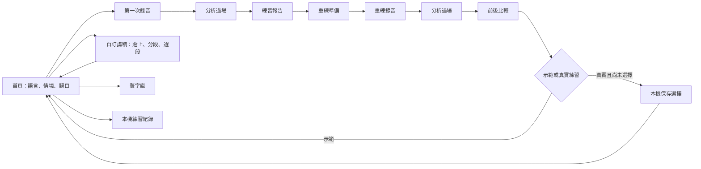
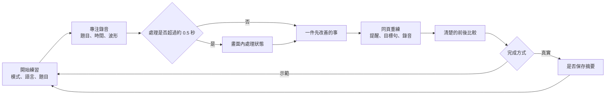
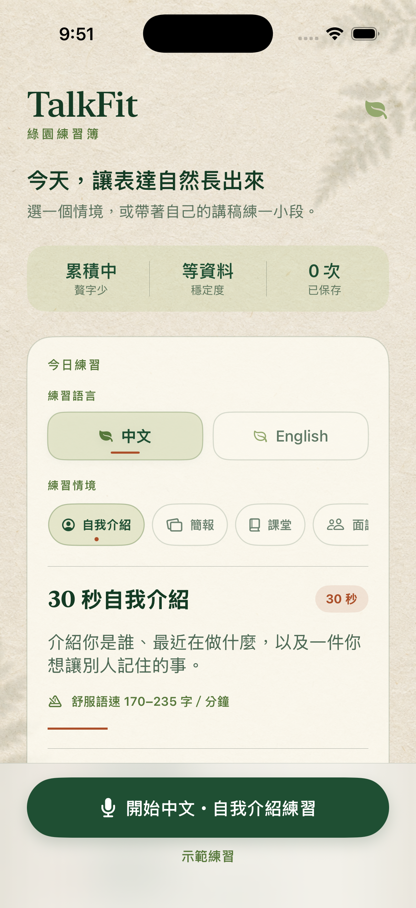
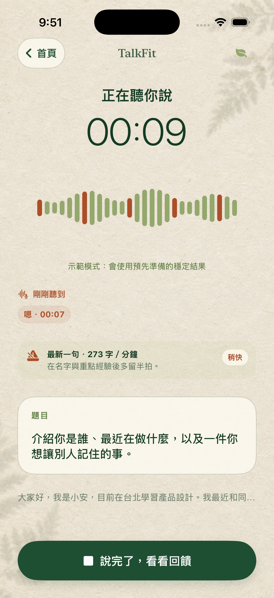
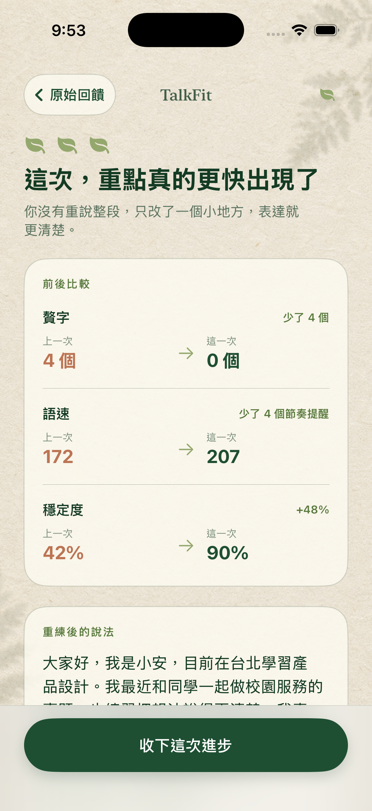

# TalkFit 畫面流程設計與優化建議

日期：2026-07-17  
裝置：iPhone 17 Pro Simulator，iOS 26.5  
範圍：首頁、示範錄音、分析過場、練習報告、重練、前後比較、完成返回，以及自訂講稿入口。

## 整體判斷

TalkFit 的核心產品命題很清楚：不是給一大堆分數，而是找出一小段立即重練，再用前後差異讓使用者看見進步。現有流程已經完整可走通，視覺語言也一致。下一階段最值得做的不是增加更多頁，而是降低錄音時的自我監控、把報告的閱讀順序重新分層，並修正比較頁的指標語意。

## 目前流程

## 建議的新流程

建議把目前 7 個主要畫面狀態壓成 5 個使用者可感知的階段：開始、第一次錄音、一件先改善的事、重練、前後比較。分析仍可存在，但只在真的需要等待時顯示；重練準備與重練錄音則使用同一個畫面切換狀態。

## 逐步稽核

### 1. 首頁 — 健康度：良好，但第一次使用的優先順序可更單純

優點：主要 CTA 固定在底部；語言、情境、題目與舒服語速都在同一個決策區；品牌感完整。

風險：第一筆資料都還沒有時，「累積中／等資料／0 次」比練習內容更早出現，會讓首用者先看到空資料；情境橫向選擇器右側被裁切，但缺少「可左右滑」的明確提示；「自訂講稿」是重要模式，卻在首屏以下。

建議：沒有歷史時隱藏成長摘要，或換成「完成一次練習後看見進步」；把練習模式提升為「情境題目／我的講稿」兩個清楚入口；保留贅字庫與歷史為次要工具。

### 2. 第一次錄音 — 健康度：功能完整，但認知負擔偏高

優點：停止按鈕明確、題目一直可見、計時與波形提供錄音信心，離開也有資料遺失保護。

風險：畫面同時顯示計時、波形、贅字證據、即時語速、節奏建議、題目與逐字稿。使用者正在說話時會開始監控自己，與「低壓力練習」定位衝突；淡綠小字疊在有紋理背景上，可能有對比與閱讀負擔。

建議：第一次錄音只留題目、計時、波形與完成按鈕；即時逐字稿可收在「顯示逐字稿」開關；贅字與逐句語速移到報告。重練錄音才顯示唯一一個 coaching cue。

### 3. 分析過場 — 健康度：可用，但目前過短而像閃頁

此狀態在示範流程約 700ms 後自動跳轉，乾淨的 Simulator 截圖來不及完成，因此沒有獨立畫面證據；操作時已確認它顯示「正在整理你的表達」與進度狀態。

建議：處理低於約 0.5 秒時直接進報告；超過門檻才在原畫面顯示處理 overlay 或 skeleton，避免固定插入一個短暫頁面。需用 VoiceOver 實測狀態變更公告是否會被完整讀出。

### 4. 練習報告 — 健康度：核心方向強，資訊順序需要重排

優點：「只先改善一段」非常符合產品承諾；優先片段與立即重練在首屏可見；逐字稿能區分文字中與聲音證據中的贅字，可信度高。

風險：總語速、穩定度與逐句節奏在長逐字稿之後，使用者要滑很久才知道整體狀態；優先片段卡本身可點，底部又有同義 CTA，造成兩個入口競爭；詳細逐句建議預設全部展開，容易壓過唯一行動。

建議順序：`一件先改善的事 → 三個摘要指標 → 立即重練 → 可展開的逐字稿 → 可展開的逐句分析`。保留底部主 CTA，優先片段卡改為資訊卡，或讓卡片只負責選段而不是直接跳頁。

### 5. 重練 — 健康度：概念非常好，但有實際裁切與空間配置問題

優點：只保留原句、單一提醒與開始按鈕，這是全流程最聚焦的一頁。

風險：目前 iPhone 17 Pro 畫面中，左上返回膠囊被裁掉，中央品牌與右側葉片也沒有正確呈現；內容集中在中上方，下半部留白很大。這不是風格選擇，而是可見的版面錯誤。

建議：讓共用返回列明確填滿可用寬度；重練準備與重練錄音可合成同一頁，按下按鈕後原位切換成計時與波形。目標句可用刪除或淡化標示將要拿掉的贅字，讓提醒更具體。

### 6. 前後比較 — 健康度：成就感強，但指標命名會誤導

優點：前後數字可快速掃讀、顏色方向一致，完成 CTA 明確，也清楚強調「只改一小段」。

風險：`語速 172 → 207` 沒有單位或舒服區間狀態，容易暗示越快越好；語速列右側卻寫「少了 4 個節奏提醒」，把兩種指標混在一起；`+48%` 對穩定度而言其實是 48 個百分點，不是相對成長率；示範流程的「收下這次進步」實際只返回首頁，且示範資料不保存，CTA 語意不精準。

建議：語速顯示為 `172 → 207 字／分鐘 · 都在舒服區間`；另外加入「節奏提醒 4 → 0」；穩定度標示 `+48 個百分點`；示範模式使用「完成示範」，真實練習使用「完成練習」，若已開啟歷史則再標明會保存摘要。

### 7. 自訂講稿 — 健康度：隱私說明清楚，入口層級偏深

優點：空狀態示例、分段規則與隱私承諾都清楚；未輸入時 CTA 正確停用。

風險：這其實是另一種主要練習模式，卻被放在首頁卡片底部；空狀態有大量垂直留白，停用 CTA 的外觀仍很接近可操作按鈕。

建議：將「情境題目／我的講稿」提升到首頁練習模式層；空狀態縮短內容高度，輸入後再展開段落選擇；停用 CTA 同時降低陰影與文字對比，並在輸入區附近補一個簡短的下一步提示。

## 優先級

### P0：先修正會誤導或破版的問題

1. 修正重練頁返回列裁切。
2. 將比較頁的「節奏提醒」移出「語速」列，補上語速單位與舒服區間狀態。
3. 把穩定度的 `+48%` 改成 `+48 個百分點`。
4. 示範與真實練習使用不同完成 CTA。

### P1：改善核心體驗

1. 錄音頁只保留必要訊號，避免即時回饋干擾口說。
2. 報告先顯示一件要改善的事與摘要，逐字稿及逐句分析預設折疊。
3. 沒有歷史資料時，把首頁成長摘要降級或隱藏。
4. 合併重練準備與重練錄音，減少一個頁面轉換。

### P2：提升探索與可用性

1. 將自訂講稿提升為練習模式入口。
2. 為情境橫向選擇器增加滑動線索或改成可完整看見的兩列版型。
3. 針對淡綠文字、紙張紋理、Dynamic Type、VoiceOver 閱讀順序與 Reduce Motion 做實機驗證。

## 可及性證據與限制

目前可從可及性樹確認主要按鈕有可辨識名稱，重要操作也多有 identifier；返回、開始、停止、重練與完成按鈕皆可被讀取。截圖只能指出可能的低對比、裁切與閱讀順序風險，不能證明 WCAG 對比值、VoiceOver 實際朗讀順序、Dynamic Type reflow、Switch Control 或動態狀態公告是否合格，這些仍需要專門測試。
